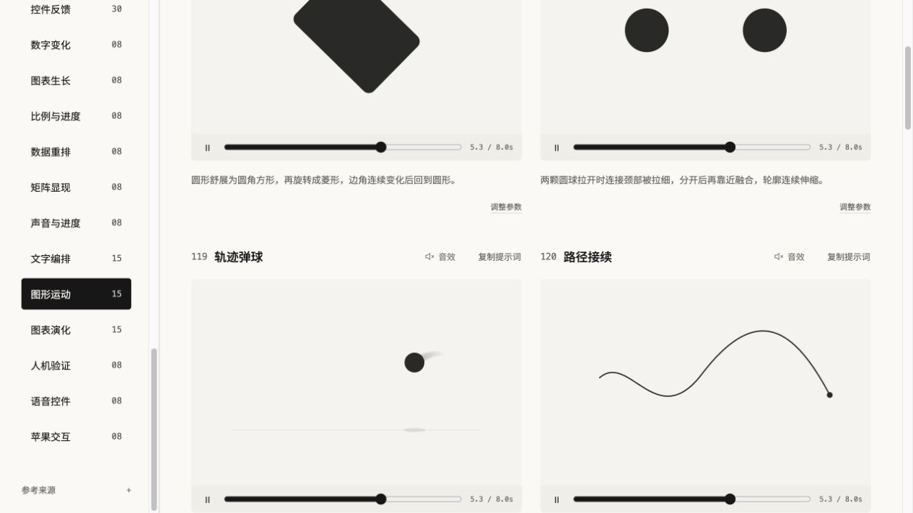

# Little Move

一个可以看、可以调、可以复用的动效词典，收录 **290 个 Demo、30 个动作分类**，覆盖文字、图片与图形、布局、控件交互和数据变化。

适合做网站时查找动作表达，也适合剪辑时按编号选择动效、复制简短提示词，再用 Remotion 组件生成视频素材。


*网站实际截图，2026-10-21。示例文字、配色和数据可调整。*

## 第一次使用

这是一个本地运行的网页应用，使用 React、Vite 和 Remotion，不是浏览器插件或已安装的 Agent Skill。

准备 Node.js 22.12+（本次实测 Node.js 24）和 npm。下载依赖时需要联网；没有必须填写的 API Key、模型账号或数据库。

把下面这段直接发给 Codex、Claude Code 或其他有终端权限的助手：

> 请下载 https://github.com/belalee-ai/little-move 到一个新目录。
> 先阅读 README，检查 Node.js 版本，再运行 npm ci 和 npm run dev。
> 打开终端显示的本地地址，不要覆盖已有文件。

也可以自己在终端运行：

```bash
git clone https://github.com/belalee-ai/little-move.git
cd little-move
npm ci
npm run dev -- --port 3108
```

打开终端返回的地址，通常为 http://127.0.0.1:3108/ 。页面需要由开发服务器提供，不能直接双击 index.html。

1. 按分区、动作类别筛选，或搜索编号、名称、动作描述。
2. 查看卡片预览；支持交互的卡片可切换“亲手试试”。
3. 点“调整参数”修改该效果支持的文字、字体、颜色、速度、图片或数据。
4. 点“复制提示词”获取编号、名称和动作说明。提示词描述视觉机制，不保证不同 AI 视频平台生成完全相同的结果。
5. 音效默认关闭，可在每张卡片标题旁选择和试听；同时只开启一张卡片。

## 里面有什么

| 分区 | 数量 |
| --- | ---: |
| 基础文字 | 53 |
| 创意字体 | 41 |
| 图片与图形 | 47 |
| 布局 | 16 |
| 交互 | 70 |
| 数据 | 63 |

每张卡片有稳定编号，筛选后不重新编号。30 个动作类别均不少于 8 项。完整清单见 [CATALOG.md](CATALOG.md)。



*真实网站画面；用于展示字形、构图和动效机制，静态截图不能呈现完整运动节奏。*

## 用于剪辑与二次开发

网页预览和 Remotion 视频组合共用按帧计算的动作逻辑。手动交互用于网页体验；视频渲染使用预设自动演示过程，不会录制鼠标操作。

```bash
# 打开 Remotion Studio，选择组合与参数
npm run studio

# 检查并构建静态网页
npm run check
npm run build
```

网页构建结果在 dist/。Remotion CLI 的视频导出需要可用的浏览器和渲染环境；首次渲染可能下载浏览器或相关运行组件。字体和默认示例素材随源码提供。

- 基础文字 001–030：WordByWord、Typewriter 等独立命名组合，具体 ID 以 Studio 清单为准。
- 创意字体 031–047、060–068：Study031 等组合。
- 其余 Demo：Demo048、Demo073 等组合。
- 参数下载只在对应设置提供时可用，不把所有 Demo 视为同一个参数结构。
- 前 30 种基础文字另有 ChatCut 载荷生成器，后续所有 Demo 并未全部验证过 ChatCut 接入。

```bash
node scripts/chatcut-payload.mjs --effect 008 \
  --text '把重点讲清楚' --out chatcut/current.json
```

应用代码位于 src/，默认素材在 public/，检查脚本在 scripts/。用自己的图片或音频替换时，需自行具备素材使用权限。

## 运行范围与验证

本次在 macOS、Node.js 24 和本地浏览器中验证。Windows、Linux 以及不同浏览器的完整使用尚未逐项实测；系统回退字体可能产生字形差异。Codex 与 Claude Code 只是可帮助安装和修改项目的助手，没有另行声称其插件安装、Skill 触发或完整客户端兼容性已验证。

语音、人机验证和苹果交互都是本地样式演示，不接入真实录音、验证码服务、系统设置或账号业务。只有 101 等支持替换声音的示例会在浏览器本地读取所选文件，不需要上传到服务端。

当前验证范围见 [发布检查](docs/RELEASE-CHECK.md)。后续补充按 [收集机制](docs/intake/WORKFLOW.md)手动启动，不设数量上限，未设置定时任务。

若页面空白，先检查终端错误与 Node.js 版本；若端口被占用，使用终端实际给出的地址。字体或图片未加载时检查网络面板与 public/ 文件是否完整，避免只复制 src/。

## 许可与来源

自有代码按 [MIT](LICENSE) 提供。字体、摄影和 Remotion 等依赖保留各自许可，**不能将整套项目描述为全部 MIT 或所有商业用途免费**。

请先读 [许可说明](docs/LICENSING.md)及 [第三方来源](THIRD-PARTY-NOTICES.md)。公开仓库排除了历史个人照片、本机路径、私有剪辑工程地址、依赖目录与旧预览产物。
