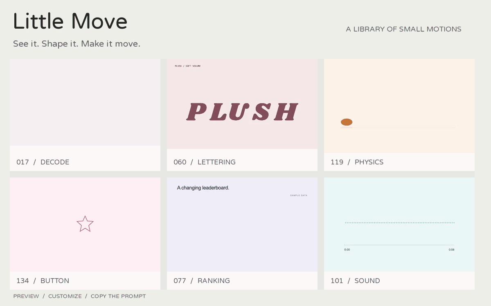
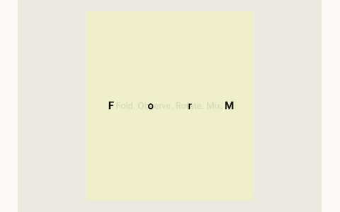
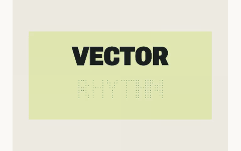
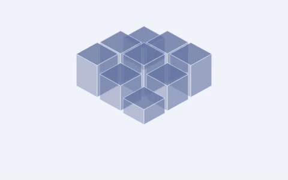
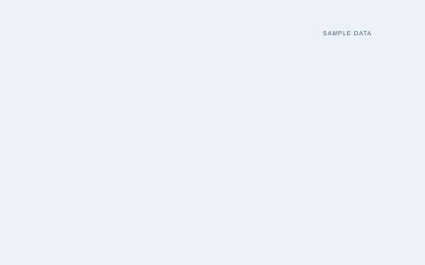
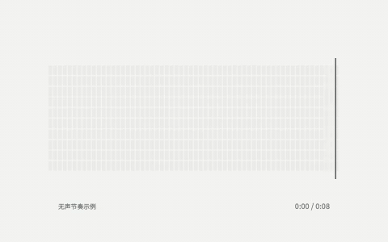
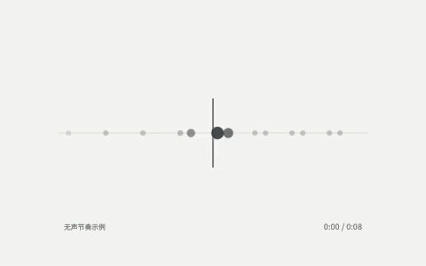

<div align="center">

# Little Move

**先看见动作，再把想法说清楚。**

293 个可预览、可调参的动效 Demo，覆盖文字、图片、布局、控件与数据。

[**打开在线动效库 ↗**](https://belalee-ai.github.io/little-move/)　·　[动态画廊](docs/GALLERY.md)　·　[完整目录](CATALOG.md)　·　[本地运行](docs/GETTING-STARTED.md)

[](LICENSE) [](CATALOG.md) [](https://belalee-ai.github.io/little-move/)

[](https://belalee-ai.github.io/little-move/)

*上面会动。六个真实组件的循环预览，点击进入在线版亲手操作。*

</div>

Little Move 把“我想要那种感觉”变成可以指给别人看的动作。做网页、产品原型或视频时，先选一个效果，调整到合适的节奏，再复制编号和提示词；需要精确实现时，可以继续使用仓库中的 React / Remotion 组件。

## 先挑一种动作

首页总览的六种动效各展示一次。下面再看六种不同的动作。

| 缩写与释义 | 反向字带 |
| --- | --- |
| [](https://belalee-ai.github.io/little-move/) | [](https://belalee-ai.github.io/little-move/) |
| **046 · 缩写展开与释义** — 字母放大重排，释义逐字展开。 | **047 · 反向字带** — 上下反向运动，连续切换字形。 |

| 立体几何 | 图表关系 |
| --- | --- |
| [](https://belalee-ai.github.io/little-move/) | [](https://belalee-ai.github.io/little-move/) |
| **125 · 立方错层** — 立方块错拍升降，顶面与侧面连续相接。 | **155 · 流量汇聚** — 带宽与流量对应，节点与流带共同出现。 |

| 滚动声谱 | 节拍轨道 |
| --- | --- |
| [](https://belalee-ai.github.io/little-move/) | [](https://belalee-ai.github.io/little-move/) |
| **278 · 滚动声谱** — 强弱变化形成滚动矩阵，游标保留播放位置。 | **279 · 节拍轨道** — 拍点沿时间轴移动，当前节拍点亮。 |

**[继续看动态画廊：另外 13 个文字、图形、交互与图表循环 →](docs/GALLERY.md)**

本次展示共选 **25 个不同编号**：总览 6 个、首页卡片 6 个、画廊 13 个，三处互不重复，不含图片展示动效。配色采用现有组件参数，设置记录在 [预览清单](docs/previews/manifest.json)。网站默认配色可能不同，动作机制一致。

GIF 由当前组件真实渲染，保留原有运动节奏；为了适合 GitHub 阅读，缩小为 20fps、静音循环展示。真实交互、音效与完整预览请[打开在线版](https://belalee-ai.github.io/little-move/)，搜索图中的固定编号。静态截图另用于说明操作入口。

## 看 → 调 → 用

| 第一步：找到动作 | 第二步：调到合适 | 第三步：带走表达 |
| --- | --- | --- |
| 按分区或动作分类筛选，也能搜索编号、名称或动作描述。 | 打开“调整参数”，修改该效果支持的文字、字体、配色、速度、图片或数据。带交互的卡片可切到“亲手试试”。 | 点“复制提示词”，拿到固定编号、名称和简短动作说明。需要源码时，在完整目录中找对应组件。 |

例如，把这段发给 AI 助手或同事：

> 参考 Little Move 的 **053 · 便当格展开**：主内容格展开时，
> 折线逐点生长，数字累加，百分比与进度同步变化；
> 完成后平稳收回网格。沿用我的配色和内容。

提示词用于描述动作。不同生成平台的结果会有差异；要精确复现，请使用对应组件与参数。网页预览与 Remotion 自动演示共用帧驱动逻辑，视频在本地渲染。

### 三个顺手的小功能

**音效**　每张卡片可以选择音色、调节音量和试听，默认关闭，同一时间只开启一张卡片。

**复制提示词**　点击后出现“已复制 ✓”，复制的是编号、名称与短动作说明，方便继续补充自己的内容。

**预览设置**　边看边调整文字、字体、配色、速度；部分效果还支持换图、数据和不同动作版本。可调项目依具体效果而定。

<details>
<summary><strong>展开操作图解：音效、复制提示词、预览设置</strong></summary>

#### 选择音效

点卡片标题旁的“音效”，选择音色、调节音量，再点“试听音色”。


#### 复制提示词

点“复制提示词”，看到成功反馈后直接粘贴。


#### 调整预览

点卡片的“调整参数”，顶部面板会切到该效果支持的设置。


</details>

## 两种用法

**直接查用**　[打开网站](https://belalee-ai.github.io/little-move/)，无需注册或安装。选动作、调参数、复制提示词，适合原型沟通、网页开发、视频分镜与剪辑参考。

**放进自己的项目**　克隆源码后，可以修改组件、替换自己的素材，或通过 Remotion 导出视频。安装、定制与导出步骤见[使用指南](docs/GETTING-STARTED.md)。

```bash
git clone https://github.com/belalee-ai/little-move.git
cd little-move
npm ci
npm run dev -- --port 3108
```

需要 Node.js 22.12+ 和 npm，本项目实测 Node.js 24。也可以直接把这句话发给有终端权限的 AI 助手：

> 请阅读 https://github.com/belalee-ai/little-move 的 README，
> 在新目录安装并启动项目，帮我找到适合当前需求的动效。
> 修改时沿用原有编号和动作机制。

这是 React / Remotion 应用。前 30 种基础文字另有 ChatCut 载荷生成器，后续 Demo 未全部验证 ChatCut 接入；不会安装成在 Agent 中自动生效的 Skill。

## 持续补充，也持续修整

当前 **293 项、30 个动作分类**，每类至少 8 项。[查看 001–293 完整目录](CATALOG.md)。

- **每 5 天检查一次**，北京时间 10:00；每批不限数量，也没有最低新增数。
- 先查原始来源与许可，对照全库去重；相同动作只换颜色或图片不算新增。
- 逐项操作真实预览、检查完整运动与渲染，通过后自动发布到 GitHub 和网站。
- 来源、工具或检查不满足条件时保留候选；不会为了更新而凑数量。

最近补充：**291 图片像素扰动 / 292 滚动弧面与颗粒 / 293 磁吸网格聚焦**。[更新与验证记录](docs/intake/UPDATES.md) · [持续更新安排](docs/intake/UPDATE-POLICY.md) · [维护工作流](docs/intake/WORKFLOW.md)

定时补充由维护者的 Codex App 执行，需要本地环境和网络可用。克隆本仓库不会自动创建任务，也不会自动写入你的 GitHub。

## 使用边界与许可

- GIF 是静音展示副本；在线卡片支持的音效需主动开启。图片、音频替换在浏览器本地读取。
- 语音、人机验证和苹果交互是样式演示，不连接真实录音、验证码服务或系统设置。
- 支持系统“减少动态效果”；完整可调范围以具体卡片为准。
- 自有代码和文档按 [MIT](LICENSE) 提供；字体、摄影与 Remotion 等依赖遵循各自许可，见[许可与素材](docs/LICENSING.md)。
- 实测范围见[发布检查](docs/RELEASE-CHECK.md)，未声称所有浏览器、设备、参数组合或 Agent 都已完整实测。

发现裁切、卡顿或动作不明显，欢迎[提交 Issue](https://github.com/belalee-ai/little-move/issues)，附上 **编号、浏览器和复现步骤**。推荐新动作时，尽量附原作者 Demo 与素材来源。
