# Little Move

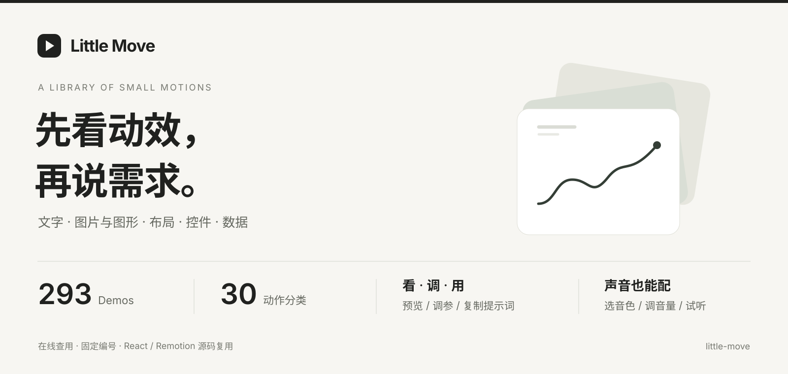

[](LICENSE) [](CATALOG.md) [](https://belalee-ai.github.io/little-move/)

**先看动效，再说需求。**

一个可以直接打开的动效词典。把“想要那种感觉”变成看得见的参考：**291 个 Demo、30 个动作分类**，覆盖文字、图片与图形、布局、控件和数据。

[**打开在线动效库 ↗**](https://belalee-ai.github.io/little-move/) · [看效果](#效果一览) · [怎么用](#三步找到你要的动作) · [本地运行](docs/GETTING-STARTED.md) · [完整目录](CATALOG.md) · [持续更新](#持续更新)

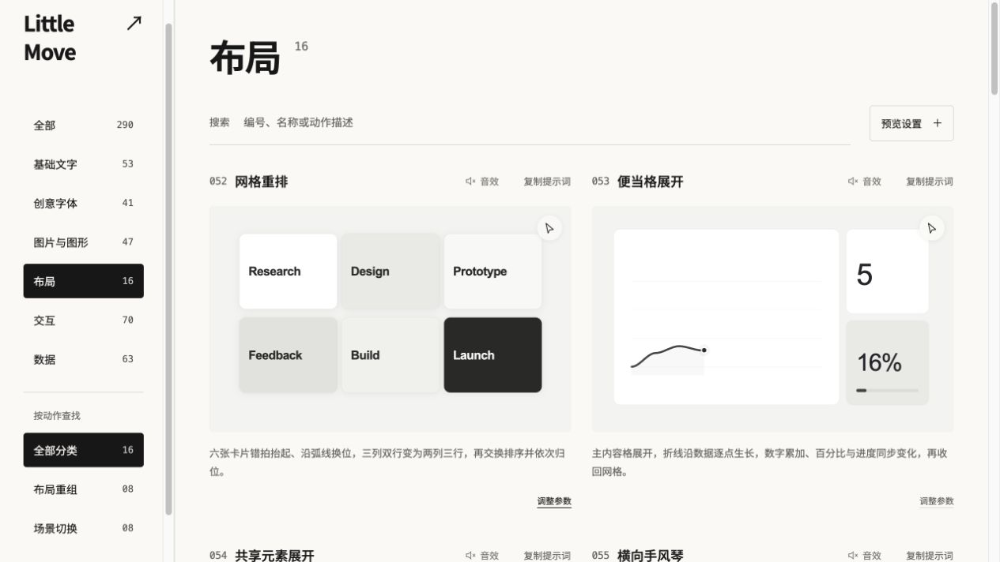

*上方头图为项目介绍；这张是在线页面的真实截图。打开链接即可查看，无需注册或安装。*

## 什么时候用

| 你在做什么 | 可以怎样使用 Little Move |
| --- | --- |
| 做网页或产品原型 | 对比按钮、输入框、拖动、布局切换的反馈方式，找到能表达状态变化的动作。 |
| 做视频或剪辑素材 | 为标题、图片转场、数字变化和语音波形选参考，再用本地 Remotion 组件生成素材。 |
| 和 AI 助手描述需求 | 复制编号、名称和简短动作说明，让“弹一点、流畅一点”有具体参照。 |
| 和团队讨论方案 | 用同一张卡片对齐动作，而不是只用文字猜彼此的意思。 |

## 三步找到你要的动作

**1 · 看**　按分区或动作筛选，也可以直接搜编号、名称、动作描述。每个 Demo 的编号固定，筛选后不会变化。

**2 · 调**　打开“调整参数”，修改该效果支持的文字、字体、配色、速度、图片或数据。带交互的卡片可切到“亲手试试”；音效默认关闭，可单独开启。

**3 · 用**　复制卡片上的提示词，把动作讲清楚；需要精确实现时，使用对应组件与参数。网页预览与 Remotion 自动演示共用按帧计算的动作逻辑。

例如，你可以这样描述：

> 参考 Little Move 的 **053 · 便当格展开**：主内容格展开时，
> 折线逐点生长，数字累加，百分比与进度同步变化；
> 完成后平稳收回网格。沿用我的配色和内容。

提示词是一份动作说明，适合用来沟通需求；不同生成平台的结果会有差异。在线页面用于预览和调参，视频渲染在本地 Remotion 中进行。

### 三个顺手的小功能

#### 给动效配声音

点卡片标题旁的“音效” → 选择音色 → 调节音量；点“试听音色”可以先听一遍。默认静音，同一时间只开启一张卡片的音效。

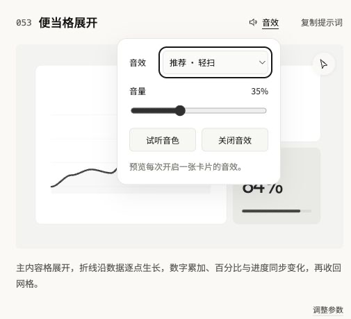

#### 一键复制动效提示词

点“复制提示词”，按钮显示 **“已复制 ✓”** 就代表成功。粘贴后会得到**固定编号、名称和简短动作说明**，可以直接发给 AI 助手或同事，再补充自己的内容与风格要求。

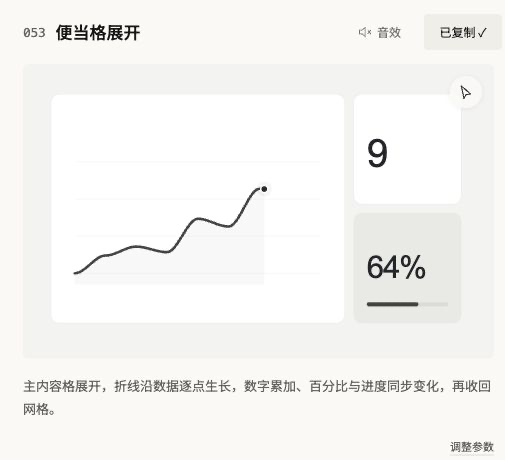

比如，053 卡片复制出来的内容是：

```text
053 便当格展开
主内容格展开，折线沿数据逐点生长，数字累加、百分比与进度同步变化，再收回网格。
```

#### 边看边调预览

点目标卡片的“调整参数”，会打开顶部“预览设置”，切到该动效支持的参数。文字、字体、颜色、速度，以及部分效果的图片、数据或动作版本，都可以边调边看。

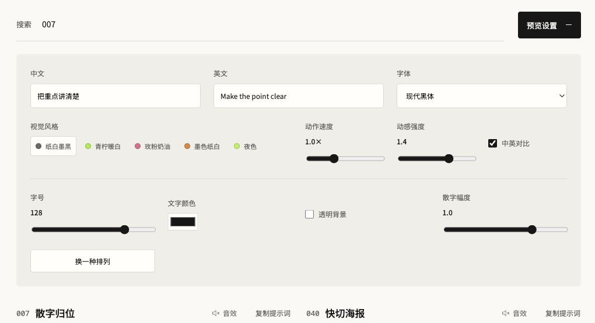

## 效果一览

| 文字与字形 | 图片与图形 |
| --- | --- |
| 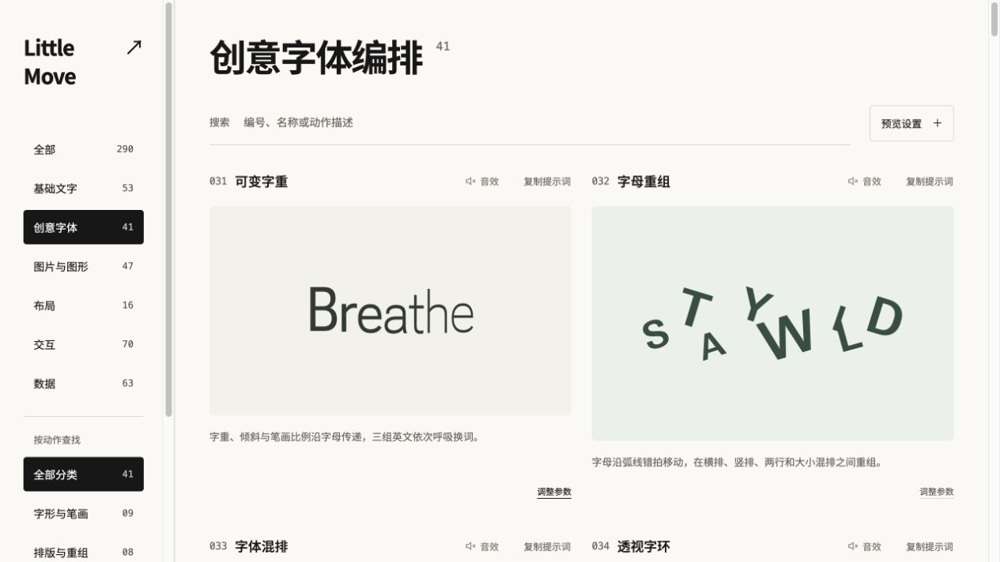 | 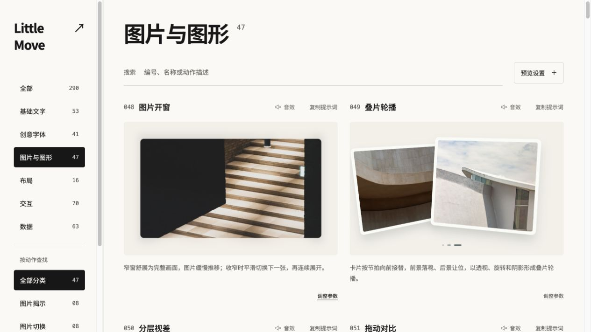 |
| 字标重组、笔画变化、空间遮挡，保留各自的字形表达。 | 图片开窗、叠片轮播、分层视差与图片对比。 |

| 布局变化 | 控件反馈 |
| --- | --- |
| 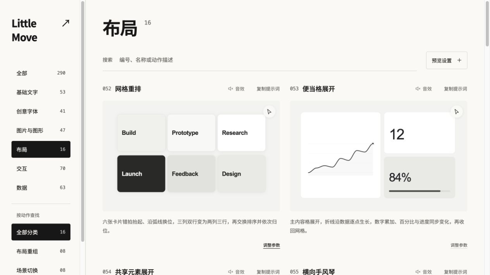 | 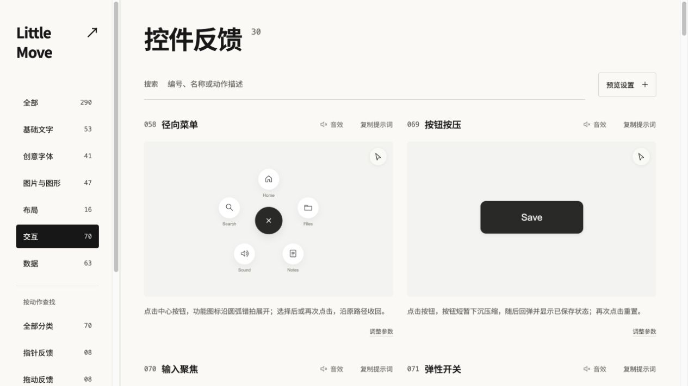 |
| 网格重排、内容展开、共享元素与场景切换。 | 按钮、输入、开关、标签页，以及拖动和选择反馈。 |

| 数据变化 | 语音交互 |
| --- | --- |
| 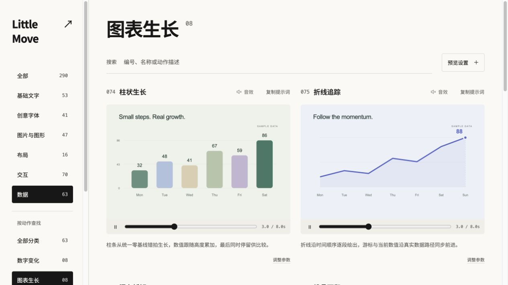 | 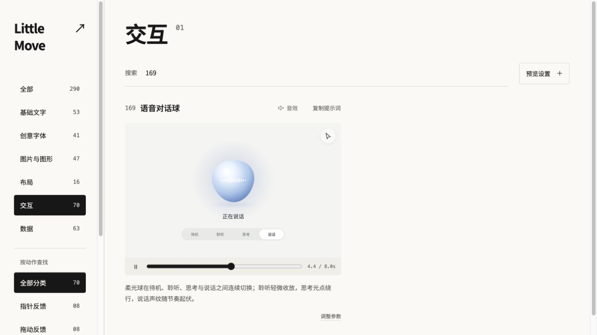 |
| 数字滚动、图表生长、占比进度、数据重排与矩阵显现。 | 聆听、思考、说话等状态，以及波形与播放进度。 |

<details>
<summary>再看基础文字</summary>

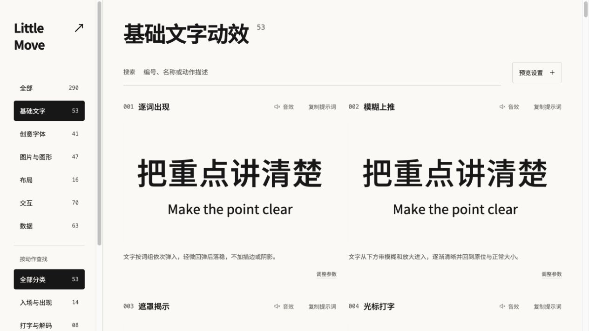

</details>

*以上均为当前版本的真实界面截图。截图展示字形、构图与操作入口；完整运动节奏请在[在线动效库](https://belalee-ai.github.io/little-move/)查看。*

## 里面有多少种

| 文字 | 创意字体 | 图片与图形 | 布局 | 交互 | 数据 |
| ---: | ---: | ---: | ---: | ---: | ---: |
| 53 | 41 | 48 | 16 | 70 | 63 |

30 个动作分类均不少于 8 项。所有卡片支持搜索、预览与简短动作说明；具体可调参数依各效果而定。[查看 001–291 完整目录](CATALOG.md)。

## 想把它用进自己的项目

**直接查用**：[打开网站](https://belalee-ai.github.io/little-move/)，找到 Demo，复制编号、名称和提示词。

**本地运行**：准备 Node.js 22.12+ 和 npm（本次实测 Node.js 24），运行：

```bash
git clone https://github.com/belalee-ai/little-move.git
cd little-move
npm ci
npm run dev -- --port 3108
```

也可以把这句话发给有终端权限的 AI 助手：

> 请阅读 https://github.com/belalee-ai/little-move 的 README，
> 在新目录安装并启动这个项目，然后帮我找到适合当前需求的动效。
> 如果要修改，请沿用原有编号和动作机制。

**定制组件或导出视频**：见[安装、定制与视频复用](docs/GETTING-STARTED.md)。这是一个 React / Remotion 应用，不是安装到 Agent 后自动生效的 Skill；前 30 种基础文字另有 ChatCut 载荷生成器，后续 Demo 未全部验证 ChatCut 接入。

## 使用前了解这些

- 语音、人机验证、苹果交互等是本地样式演示，不连接真实录音、验证码服务或系统设置。
- 图片、音频替换由浏览器本地读取；没有必须配置的模型账号、API Key 或数据库。首次打开会加载字体和当前预览所需素材。
- 支持系统“减少动态效果”；在可见范围内播放预览，音效由用户主动开启。
- 自有代码按 [MIT](LICENSE) 提供；字体、摄影和 Remotion 依赖遵循各自许可，详见[许可与素材](docs/LICENSING.md)。
- 验证范围见[发布检查](docs/RELEASE-CHECK.md)。未声称所有浏览器、设备、参数组合或 Agent 都已完整实测。

最近新增 **291 · 图片像素扰动**：图片局部方块随指针错位、拖尾并复原，支持换图、调节幅度和方向键体验。[看本轮更新与验证](docs/intake/UPDATES.md)。

## 持续更新

**每 5 天检查一次，验收通过后自动发布。每批不设数量上限，也不设最低新增数。**

| 你关心的事 | 我们如何处理 |
| --- | --- |
| 多久更新 | 维护者的定时任务已启用：每 5 天，北京时间 10:00 运行；有合格成果才更新网站。 |
| 一次增加多少 | 不限量，以机制差异、使用价值和验收结果为准；可以新增、优化旧效果，也可以本轮不收录。 |
| 怎么保证质量 | 查原始来源与许可 → 对照全库去重 → 制作组件 → 逐项看真实预览、操作与渲染 → 检查构建。 |
| 什么时候上线 | 通过检查后自动提交到 GitHub，再由 GitHub Pages 发布，并回读线上新增或修改的词条。 |
| 没通过怎么办 | 保留候选或写明阻塞，不把换色变体、未实现参考或检查失败项计入正式 Demo。 |

定时补充运行在维护者的 Codex App 中，需要本地执行环境与网络可用；克隆仓库不会自动启用任务。完整流程、状态与失败处理见[持续更新安排](docs/intake/UPDATE-POLICY.md)和[补充工作流](docs/intake/WORKFLOW.md)。

## 参与补充

发现裁切、卡顿、动作不明显，欢迎[提交 Issue](https://github.com/belalee-ai/little-move/issues)，附 **编号、浏览器、复现步骤或录屏**。

建议新动作时，说明适用场景与动作机制；尽量附原始演示链接和素材来源。我们关注动作上的差异，而不只是更换颜色。补充工作流见[收集机制](docs/intake/WORKFLOW.md)；也可以手动提前运行一轮，沿用相同的质量门槛。
