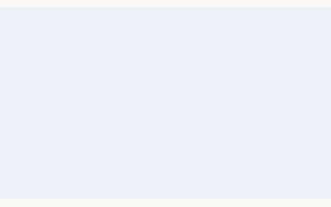
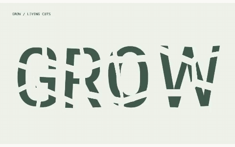
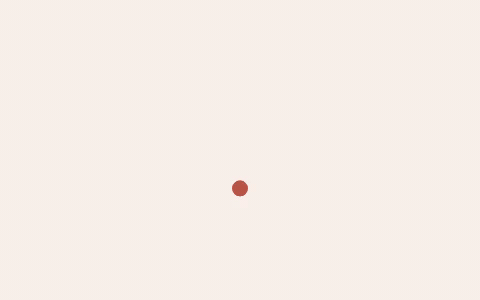
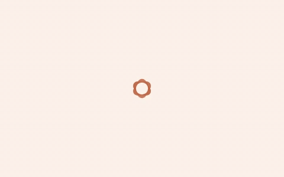
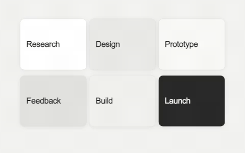
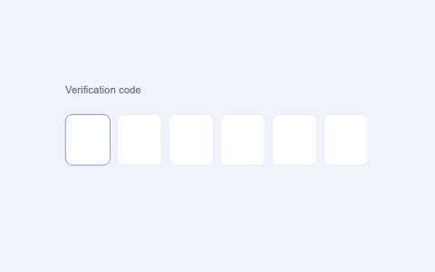
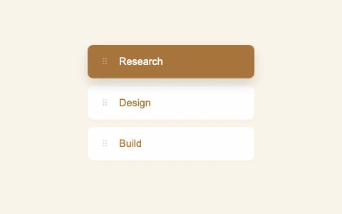
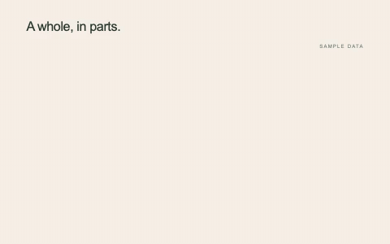
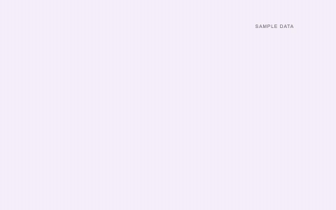
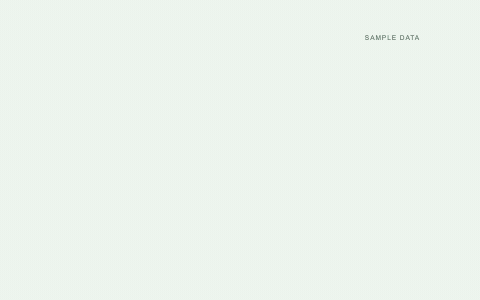

# Little Move · 动态画廊

[打开在线动效库 ↗](https://belalee-ai.github.io/little-move/) · [返回首页](../README.md) · [001–293 完整目录](../CATALOG.md)

这一组选择了 **25 个不同编号、不含图片展示的动效**：首页总览 6 个、首页卡片 6 个，本页再展示另外 13 个，三处互不重复。它们的区别来自动作机制，涵盖文字、几何、布局、控件、图表和声音。

每张 GIF 都由现有组件完整渲染，保留原节奏，缩小为 480×300、20fps。配色采用组件已有参数，完整设置见 [预览清单](previews/manifest.json)；网站默认配色可能不同。GIF 静音，不接受鼠标或键盘输入；体验真实控件与音效，请打开在线版，搜索编号。

## 文字与艺术字

| 007 · 散字归位 | 032 · 字母重组 |
| --- | --- |
|  |  |
| 蓝色文字从不同位置和角度聚拢，拼成完整句子。 | 字母在横排、竖排、两行和大小混排之间错拍移动。 |

| 063 · 细胞切割字 | 105 · 标点变奏 |
| --- | --- |
|  |  |
| 字内细胞分裂、舒展并合拢，切口持续迁移。 | 圆点、冒号、问号与感叹号以笔画变形连续接续。 |

| 110 · 笔迹显字 | 113 · 字内流动 |
| --- | --- |
|  |  |
| 绿色细线跟着笔头连续转折，逐笔描成字形。 | 蓝色圆点、条带和圆弧在固定字形内部穿行。 |

## 图形、布局与操作

| 123 · 花瓣开合 | 052 · 网格重排 |
| --- | --- |
|  |  |
| 陶橙色花瓣绕中心错拍展开，轻旋后合拢。 | 卡片抬起、沿弧线换位，行列与顺序一起重组。 |

| 140 · 验证码输入 | 146 · 拖动重排 |
| --- | --- |
|  |  |
| 数字逐格进入，蓝色焦点依次迁移，完成后显示确认。 | 暖色卡片被抓起，邻项让位，松手后落到新的行位。 |

## 图表与声音

声音动效已在[首页](../README.md#先挑一种动作)展示，这里继续看三种不同的数据变化。

| 076 · 环图展开 | 151 · 频数分箱 | 157 · 百格填充 |
| --- | --- | --- |
|  |  |  |
| 珊瑚色环段按占比生长，数字与弧长同步。 | 紫色样本逐颗落入区间，柱高按真实频数累加。 | 绿色单元按占比成组点亮，已亮格数与数值一致。 |

## 带到自己的项目

在在线版搜索编号 → 调整支持的参数 → 复制提示词。要精确复现动作，使用对应源码组件与预览清单中的设置；视频输出参考[安装、定制与视频复用](GETTING-STARTED.md)。

声音类使用示例节奏；GIF 静音，不采集麦克风。以上只展示所选编号与参数，不代表全部 293 项或所有参数组合。字体、代码与依赖分别遵循自己的许可，见[许可与素材](LICENSING.md)。

维护者运行 `node scripts/render-readme-previews.mjs` 更新动图；已有本地 MP4 时用 `--encode-only` 重新编码。原视频留在忽略提交的 `proof/readme/`，公开副本和配置位于 `docs/previews/manifest.json`。
