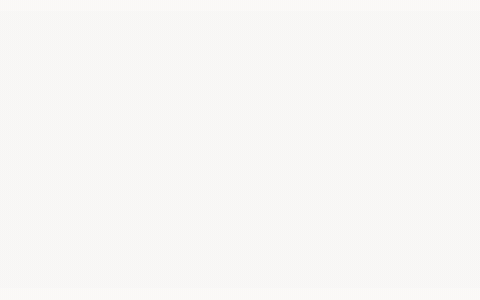
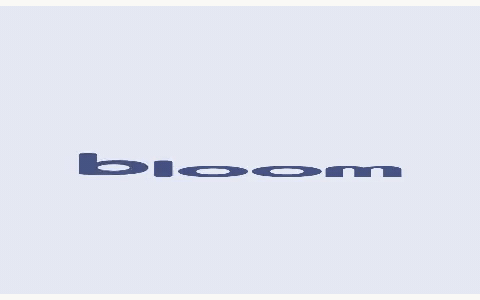
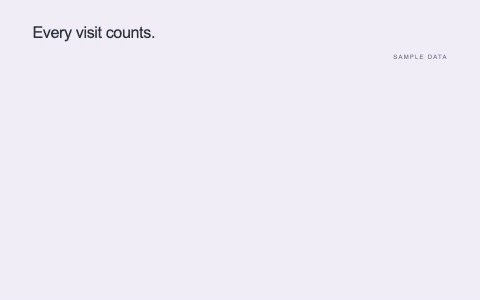
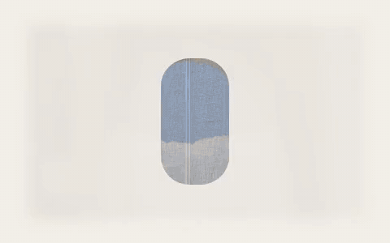
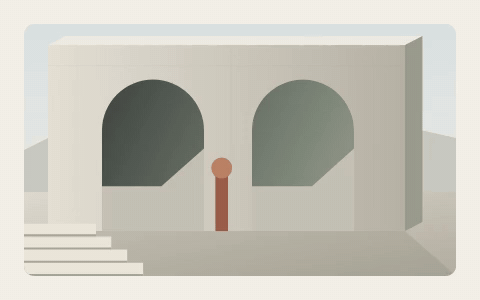
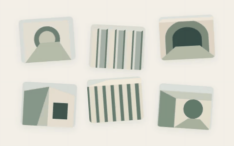
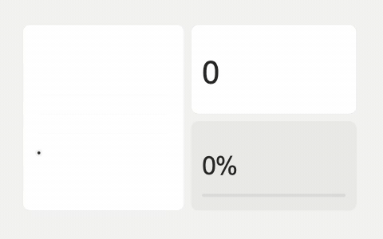
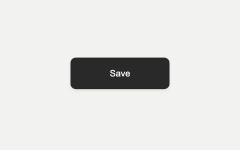
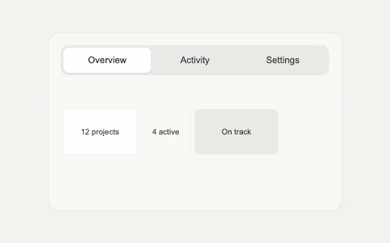
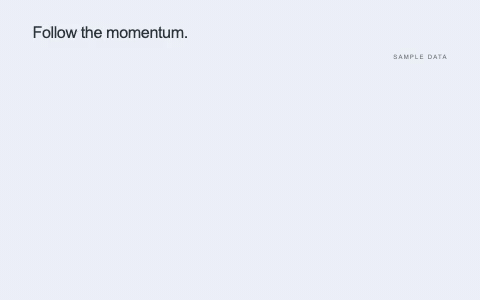

# Little Move · 动态画廊

[打开在线动效库 ↗](https://belalee-ai.github.io/little-move/) · [返回首页](../README.md) · [001–293 完整目录](../CATALOG.md)

这里展示 12 个现有组件的完整循环。每张 GIF 都由项目当前实现真实渲染，按原节奏缩小为 480×300、20fps；不是静态截图拼接，也没有另写一套展示动画。GIF 静音，不接受鼠标或键盘输入；体验真实控件和音效，请打开在线版，搜索对应编号。

## 文字与字形

| 008 · 停顿打字 | 022 · 霓虹呼吸 |
| --- | --- |
|  |  |
| 字号固定，光标逐字前进，字间有轻重停顿。 | 明亮灯芯与彩色光晕一起收放，暗下时保留灯管形态。 |

| 035 · 字标重组 | 073 · 数字滚动 |
| --- | --- |
|  |  |
| 展示波浪展开版本；在线参数还可切换弹性聚拢与翻转落位。 | 数字各列连续滚动，错拍启动，再逐列减速落位。 |

## 图片与空间

| 048 · 图片开窗 | 291 · 图片像素扰动 |
| --- | --- |
|  |  |
| 窄窗展开，图片缓慢推进，收窄时切到下一张。 | 图中展示自动指针路径；在线可移动指针，让局部像素错位并留下拖尾。 |

| 293 · 磁吸网格聚焦 | 053 · 便当格展开 |
| --- | --- |
|  |  |
| 多张图独立响应指针；选中图连续展开，其他图错拍撤离，再回到网格。 | 主格展开时，折线、计数与百分比同步变化，再收回原布局。 |

## 控件、数据与语音

| 069 · 按钮按压 | 072 · 滑块标签页 |
| --- | --- |
|  |  |
| 下沉、回弹，再切换到 Saved 状态；在线可以真实点击。 | 底块平滑滑向选中项，内容顺势错位切换；在线支持点击与方向键。 |

| 075 · 折线追踪 | 169 · 语音对话球 |
| --- | --- |
|  |  |
| 折线逐段绘出，游标与当前数值一起前进。 | 待机、聆听、思考和说话连续切换；使用示例节奏，不采集麦克风。 |

## 带到自己的项目

在在线版搜索编号 → 调整支持的参数 → 复制提示词。要精确复现动作，继续使用对应源码组件；要输出视频，参考[安装、定制与视频复用](GETTING-STARTED.md)。

这些预览只代表所列 Demo 的当前默认配置，不代表 293 项或所有参数组合均展示在此。字体、摄影、代码与依赖分别遵循自己的许可，见[许可与素材](LICENSING.md)。

维护者可以运行 `node scripts/render-readme-previews.mjs` 更新本页动图；已有本地 MP4 时用 `--encode-only` 重新压缩。原视频留在忽略提交的 `proof/readme/`；公开副本、编号、尺寸与时长信息位于 `docs/previews/manifest.json`。
