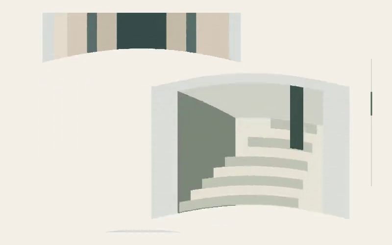
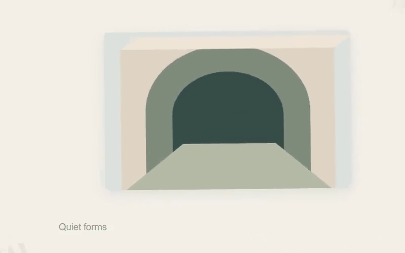
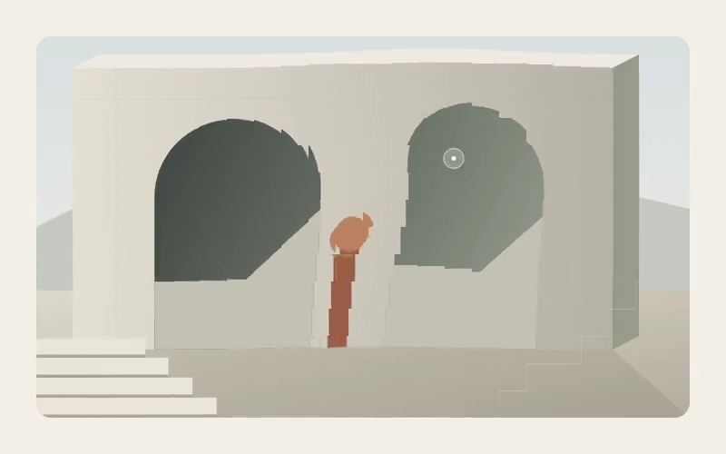

# Little Move 更新与验证

## 2026-10-21 · 292–293 候选验证与收录

剩余 2 个候选均完成机制对比、原版操作、许可核验与本地实现，正式目录由 291 项增至 **293 项**，保留原有编号。当前候选队列无待验证项；没有数量配额。

### 292 · 滚动弧面与颗粒

实际上下滚动原版示例后，保留“速度决定曲率、方向反转使曲率翻转、停下恢复清晰”的机制。它改变图片自身的曲面，与 050 整层位移、291 局部像素错位不同。自动长廊包含前进、停顿、继续、反向与回位；真实操作支持滚轮、上下拖动、方向键和 Home / End。

来源：[Jan Kohlbach / Codrops 原文](https://tympanus.net/codrops/?p=78948)、[实际操作的原版 Demo](https://tympanus.net/Tutorials/ShaderOnScroll/)、[原仓库](https://github.com/jankohlbach/codrops-shader-on-scroll)。2026-10-21 读取 MIT 许可全文，并观察正反向滚动的曲面变化。

### 293 · 磁吸网格聚焦

六张缩略图各自响应指针，产生不同的位移、倾斜和纵深；点击后其余图错拍撤离，选中图片保持同一元素连续进入详情，再原路回到网格。区别于 054 单张内容卡的尺寸展开，本项包含多元素磁吸与协调撤离；可以中途返回，保留运动速度，结束后焦点回到原缩略图。

来源：[Manoela Ilic / Codrops 原文](https://tympanus.net/codrops/2021/04/21/magnetic-3d-grid-interaction-with-content-preview/)、[实际操作的原版 Demo](https://tympanus.net/Development/3DGridContentPreview/)、[原仓库](https://github.com/codrops/3DGridContentPreview)。2026-10-21 读取 MIT 许可全文，实际移动指针、打开详情并操作返回入口。

两项均为独立实现，未复制上游代码、字体、照片或声音。九幅默认建筑示意插画由本项目绘制，生成源可复用；可以分别替换为自己的素材，没有引入新依赖。

### 验证与修复

- 网页自动演示与 Remotion 共用按帧计算的状态与绘制组件，手动输入由同一帧时钟平滑衔接。
- 两项各导出 7 个阶段帧、1 个减少动态效果帧和完整 8 秒、800×500、60fps 视频；打开实际 MP4，并回看最终文件抽取的开始、运动、反向/展开、结束帧。确认九幅图正确加载，循环回位，未发现文字或图片异常裁切。
- 292 真实操作检查滚轮、方向键、拖动和停下复原；换图、2 倍速与 1.5 幅度设置后还原。修复了分片绘制的细接缝，改为连续曲面位移。
- 293 真实点击不同缩略图、返回、运动中 Escape 打断、焦点回到原缩略图；测试换图、完整展示和还原。修复了返回按钮与演示开关的重叠。
- 两项在 390×844 视口检查图片、说明和入口，页面无横向溢出；系统减少动态效果时取消曲面、颗粒和指针纵深，状态可直接切换。浏览器没有新增运行错误。
- 类型检查、293 项目录覆盖、全部卡片音效配置、本批机制检查、291 像素扰动回归、原有机制/原生动效/连续性检查均通过。专项检查覆盖 25/30/60fps、0.5/1/2 倍速、速度连续反向、范围边界、全部非选中图撤离和精确循环端点。
- /little-move/ 构建与资源路径检查通过；本批检查已加入发布流程。没有删除已有机制质量断言。
- 过程帧、视频和浏览器截图保留在本地 proof/intake-studies/，公开截图为最终视频中的真实帧。此次只验证新增项及受影响入口，没有重新逐条验收全部 293 项或所有参数组合。

### 发布状态

本地检查已通过，等待推送、GitHub Pages 部署和线上回读；完成后在此补记实际提交与发布记录。

## 2026-10-21 · 291 图片像素扰动

本轮新增 1 项，正式目录从 290 项增至 **291 项**，动作分类仍为 30 类；没有修改旧编号。其余 2 个候选保持待确认，不计入可用 Demo 数量。

### 动作差异

指针经过的局部方块沿移动方向错位采样图片，产生有时间衰减的拖尾；停下或移开后自然复原。与 041 的字形笔画、050 的整层视差、121 的粒子聚合不同，本项改变的是图片局部采样位置。

支持自动演示、真实指针、方向键、图片替换、完整展示/裁切、速度、幅度、背景和已有音效选项。自动演示与 Remotion 共用纯帧时钟；手动输入作为带时间戳的轨迹进入同一绘制组件。视频不录制实时鼠标。

*从最终 800×500、60fps、8 秒的 MP4 抽取。静帧展示块状错位；连续运动请在在线网站搜索 291 查看。*

### 来源与素材

- 原作者：Yuri Artiukh（akella）。[Codrops 原文](https://tympanus.net/codrops/?p=58318)、[实际操作的 Demo 3](https://tympanus.net/Development/DistortedPixels/index3.html)、[作者仓库](https://github.com/akella/DistortedPixels)。2026-10-21 读取原文并在浏览器实际移动指针，确认局部块状错位与衰减复原。
- 上游仓库 MIT 许可正文已读取；本项独立使用 SVG 与纯函数实现，没有复制上游 Three.js 代码、字体、脑部渲染图或其他图片。
- 默认 `quiet-courtyard.svg` 是本项目新绘制的建筑示意插画，无新增第三方图片或字体；允许替换为自有图片。

### 本地验证

- `npm run check`、`check-pixel-field.mjs`、`check-coverage.mjs`、`check-sounds.mjs` 通过。
- `check-original-quality.mjs`、`check-native-motion.mjs`、`check-continuity.mjs` 通过，保留已有机制质量断言，只将正式总数检查更新为真实的 291。
- `/little-move/` 路径构建与 `check-web-build.mjs` 通过；没有引入新运行依赖。
- 帧逻辑检查覆盖 25/30/60fps、0.5/1/2 倍速、位移边界、速度反向、停顿衰减、循环跨界轨迹清理、零强度和减少动态效果。
- 浏览器实际测试自动演示、指针路径、移开复原、方向键、PNG 替换、完整展示模式、幅度 1.5 和还原；390×844 视口检查卡片与说明可读、无横向溢出。
- 仿真“减少动态效果”后位移归零，测试后恢复；本地浏览器无新增运行错误。
- Remotion 导出 7 个阶段帧、1 个减少动态效果帧，以及完整 8 秒 MP4；回看最终视频运动画面和抽取的首/中/尾帧，确认素材加载、裁切和首尾复原。视频探测为 800×500、60fps、480 帧、8.000 秒。
- 过程帧、视频和浏览器截图保留在本地 `proof/pixel-field/`，未作为运行素材进入公开仓库。

### 发布状态

**已发布，并完成线上回读。** 实现提交为 `52da8692d5cc771250f8282c4684f8e8fd1e69b7`；[GitHub Actions 发布运行](https://github.com/belalee-ai/little-move/actions/runs/39582615553) 的构建和部署均成功。

在 [正式网站](https://belalee-ai.github.io/little-move/) 搜索 291，已确认当前目录 291 项、建筑示意素材加载、自动位移变化、真实指针拖尾、移开复原、提示词复制成功，以及速度/幅度/图片替换参数入口；浏览器未记录运行错误。GitHub 首页、目录、头图与仓库简介已同步数量。

这是本轮新增项及受影响入口的验证结果，未声称重新逐条审查全部 291 项或所有设备。
